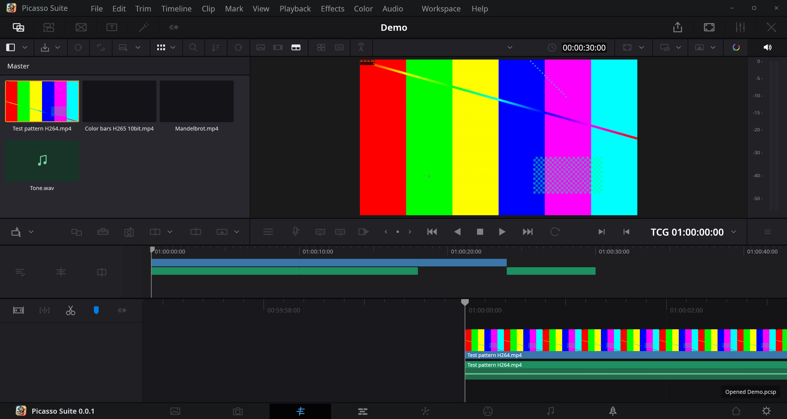
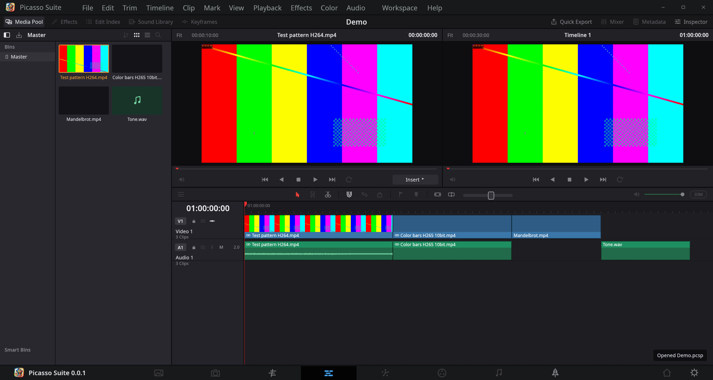
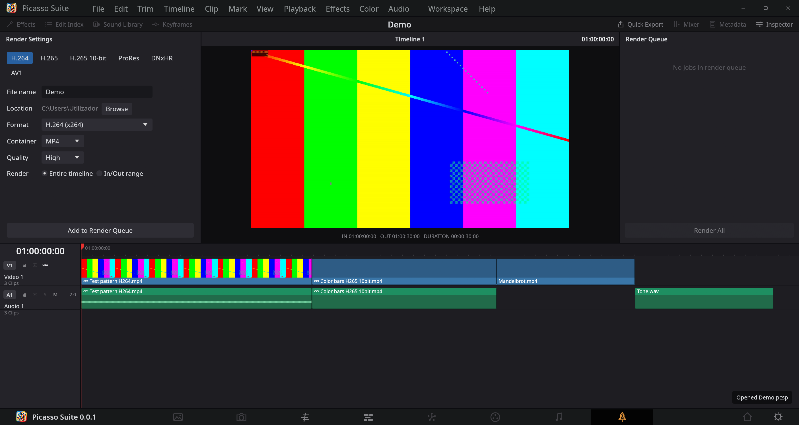

# Picasso Suite

A cross-platform video editor written in Rust — Windows, Linux and macOS.

- **Edit:** media pool, multi-track timeline (video + audio), linked picture/sound,
  drag-and-drop, move, trim, split (Ctrl+B), delete / ripple delete, snapping,
  per-clip zoom/position/opacity/volume, undo/redo.
- **Any format FFmpeg reads:** H.264, H.265/HEVC, ProRes, DNxHR, AV1, VP9, MPEG-2,
  image sequences (EXR, DPX, TIFF, PNG…), stills, WAV/FLAC/MP3/AAC… Hardware decoding is
  used for H.264/H.265/AV1/VP9 when available.
- **Export:** H.264 and H.265 (8- and 10-bit) via x264/x265, NVIDIA NVENC, Intel Quick Sync,
  AMD AMF, VA-API (Linux) and VideoToolbox (macOS) — whichever your FFmpeg build has — in
  MP4/MOV/MKV; plus ProRes, DNxHR, AV1, VP9, FFV1, PNG sequences, WAV and MP3.
- **DaVinci Resolve projects:** open `.drp` files (timeline, tracks, clips, media paths,
  resolution, frame rate). Media paths from any OS are relinked automatically.
  Send timelines back to Resolve (or Premiere/Avid) with OpenTimelineIO export.

## Screenshots

**Cut** — fast assembly with an overview strip and a zoomed detail timeline.



**Edit** — media pool, source and timeline viewers, multi-track timeline.



**Deliver** — H.264, H.265, ProRes, DNxHR and AV1 export presets with a render queue.



## Requirements

- **Rust** 1.85+ (`rustup`)
- **FFmpeg 6 or 7** (`ffmpeg` and `ffprobe`) on `PATH`, next to the executable, or set via
  `PICASSO_FFMPEG` / `PICASSO_FFPROBE`.

| OS | FFmpeg | Extra build packages |
|---|---|---|
| Windows | `winget install ffmpeg` | — |
| macOS | `brew install ffmpeg` | Xcode command-line tools |
| Debian/Ubuntu | `sudo apt install ffmpeg` | `sudo apt install build-essential pkg-config libxkbcommon-dev libgl1-mesa-dev libwayland-dev libx11-dev libxcursor-dev libxrandr-dev libxi-dev xdg-desktop-portal` |
| Fedora | `sudo dnf install ffmpeg` (RPM Fusion) | `sudo dnf install gcc pkgconf libxkbcommon-devel mesa-libGL-devel wayland-devel libX11-devel xdg-desktop-portal` |
| Arch | `sudo pacman -S ffmpeg` | `sudo pacman -S base-devel libxkbcommon mesa wayland libx11 xdg-desktop-portal` |

## Build and run

```bash
cargo run --release --bin picasso-suite
```

Open a project directly: `picasso-suite path/to/project.pcsp` (or a `.drp`).

### Command line

```bash
cargo run --release --bin picasso -- presets
cargo run --release --bin picasso -- new edit.pcsp a.mp4 b.mov music.wav
cargo run --release --bin picasso -- render edit.pcsp out.mp4 --preset h265_10bit
cargo run --release --bin picasso -- import-drp project.drp edit.pcsp --search /mnt/footage --map "D:\Footage=/mnt/footage"
cargo run --release --bin picasso -- otio edit.pcsp edit.otio
```

## Keyboard

| Key | Action |
|---|---|
| Space | Play / pause |
| ← / → (Shift: 1 s) | Step |
| Home / End | Start / end |
| Ctrl/Cmd+B | Split at playhead (selected clips, or all) |
| Del / Shift+Del | Delete / ripple delete |
| Ctrl/Cmd+Z, Ctrl/Cmd+Shift+Z | Undo / redo |
| Ctrl/Cmd+I / E / S / O / N | Import / export / save / open / new |
| + / −, Ctrl+wheel | Zoom timeline |
| Alt while dragging | Disable snapping |

## DaVinci Resolve `.drp` notes

`.drp` import reads the plain-XML parts of Resolve's export: timelines, tracks, clip
positions, source in-points, media paths, frame rate and resolution. Grades, Fusion
compositions, titles/generators, effects and transitions are stored by Resolve in
undocumented binary blobs and are **not** imported (titles/generators are counted and
skipped). The current timeline of the project is imported.

Media that moved is found by, in order: the original path; `PICASSO_PATH_MAP`
(`"D:\Footage=/mnt/footage;/Volumes/Media=/media/me/Media"`); a search under the folder
holding the `.drp` and its parent. Anything still missing is imported offline — use
**File ▸ Relink missing media…**.

Picasso Suite does not write `.drp` files. To move an edit into Resolve, use
**File ▸ Export timeline as OpenTimelineIO** and in Resolve **File ▸ Import ▸ Timeline**.

## Layout

```
crates/
  picasso-core     project model, editing operations, undo, .pcsp files
  picasso-media    FFmpeg discovery, probing, frame decoding, export presets
  picasso-render   compositor, decoder pool, export pipeline
  picasso-interop  .drp import, OpenTimelineIO export, cross-OS relinking
  picasso-app      the desktop app (egui)
  picasso-cli      the `picasso` command-line tool
docs/resolve-architecture-reference.md   clean-room reference from Resolve's public SDKs
```

`cargo test --workspace` runs the unit tests (no FFmpeg needed for them).
